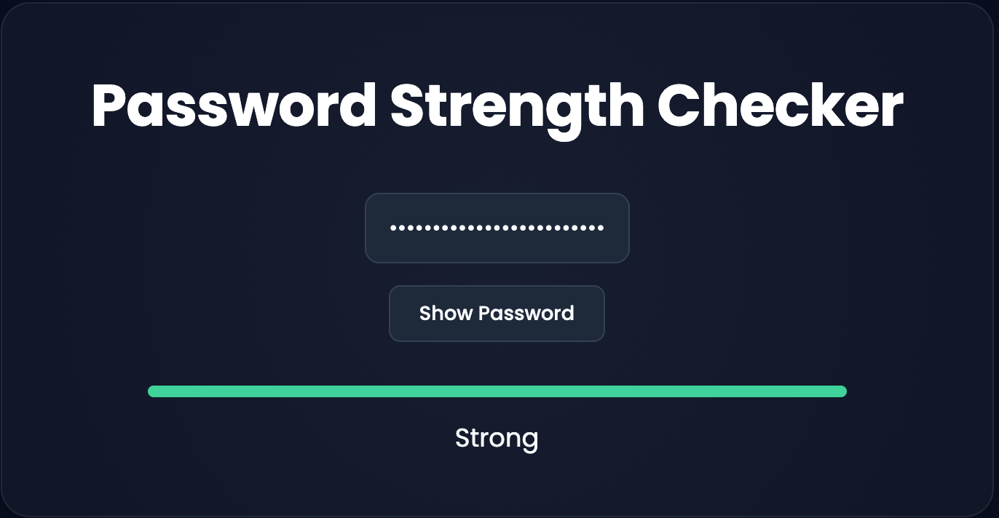

# Password Strength Checker v1

A lightweight web application that evaluates password strength in real time using JavaScript and rule-based validation.


## Live Demo
https://hexhunter-dev.github.io/password-strength-checker/


## About

This project was built as part of my web portfolio to practise my JavaScript skills and gain experience building interactive browser applications without external frameworks.


## Features

- Real-time password strength evaluation
- Rule-based validation system:
  - Minimum length check
  - Uppercase detection
  - Lowercase detection
  - Numeric character detection
  - Special character detection
- Visual strength indicator (colour-coded)
- Responsive UI design

## Screenshot

Real-time password strength feedback.




## Tech Stack


## Installation

Clone the repository:

```bash
git clone https://github.com/HexHunter-Dev/password-strength-checker.git
```

Open `index.html` in your browser.

## Usage

1. Type a password.
2. The application evaluates its strength.
3. Missing requirements are highlighted.

## Limitations

This project estimates password strength using predefined rules. It does not calculate true password entropy or check against leaked password databases.

## Future Improvements

- Password entropy calculation
- Have I Been Pwned API integration
- Password generator
- Theme switching (Light mode ↔ Dark mode)
- Accessibility Improvements
- UI/UX improvements

## What I learned

- DOM manipulation
- Event listeners
- String validation
- Regular expressions
- Writing maintainable JavaScript


## License
MIT
